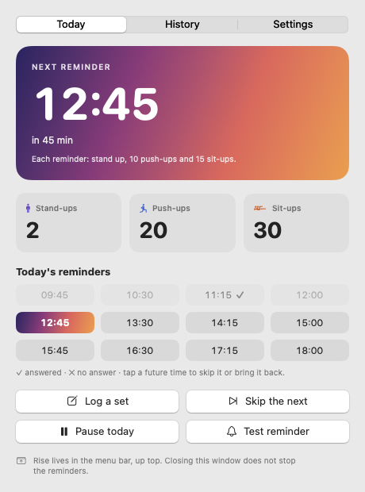

# Rise: stand-up reminder with push-ups and sit-ups for macOS

**Rise** is a free and open-source **macOS menu bar app** that reminds you to **stand up every 45 minutes** while you
work, and asks whether you did your **push-ups and sit-ups**. Every answer goes into a **workout history with line
charts**, so you can see how much you moved each day instead of sitting all day at the desk.

🇧🇷 [Leia em português](README.pt-BR.md)

<p align="center"></p>

## Download

**[⬇ Download the latest Rise (.dmg)](https://github.com/VSSSP/rise/releases/latest)**: universal app for Apple
Silicon and Intel Macs, macOS 14 Sonoma or later.

1. Open the dmg and drag **Rise** into **Applications**.
2. Open Rise. Rise is open source but not notarized by Apple, so the first time macOS may say it cannot verify the
   developer: open **System Settings › Privacy & Security** and click **Open Anyway** (or run
   `xattr -dr com.apple.quarantine /Applications/Rise.app` in Terminal).
3. Rise has no Dock icon: it lives in the **menu bar**, next to the clock (the little standing figure).

## Features

- **Stand-up reminder** every 45 minutes in work hours (start, end, interval and weekdays are configurable).
- **A check-in card that stays** on screen until you answer: over every app, Space and full-screen window, and it
  never steals the keyboard focus.
- **Push-up and sit-up tracker**: mark *Done* or *Not done* for standing up, push-ups and sit-ups, and adjust the
  count before saving. *All done*, *Did nothing* and *Snooze 5 min* are one click.
- **Music on the reminder**: pick one of the musical ringtones built into macOS or use your own song, with a volume
  control and a preview.
- **History with line charts** for 7 and 30 days (push-ups, sit-ups and stand-ups per day) and the full log of
  every reminder, including the ones left without an answer. A wrong entry can be deleted.
- **Menu bar menu**: next reminder, today's totals, log a set by hand, skip the next reminder, pause for today.
- **English and Brazilian Portuguese**, automatic or chosen in Settings.
- **Private**: no account, no network, no tracking. Everything stays on your Mac in
  `~/Library/Application Support/Rise/history.json`.
- Opens at login, and a Mac that slept through a reminder does not ring late.

## Screenshots

<p align="center">
  
  
</p>

## Build from source

Needs only the Xcode Command Line Tools (`xcode-select --install`), Swift 6.1 and macOS 14 or later.

```sh
git clone https://github.com/VSSSP/rise.git
cd rise
scripts/build.sh            # runs the tests and creates dist/Rise-<version>.dmg
scripts/build.sh --install  # also replaces /Applications/Rise.app and restarts it
swift test                  # only the planner and history tests
```

SwiftPM, AppKit with SwiftUI views and Swift Charts. `Sources/RiseCore` holds the tested logic (the reminder planner
and the history); `Sources/Rise` holds the app.

## License

[MIT](LICENSE). Contributions and translations are welcome.
