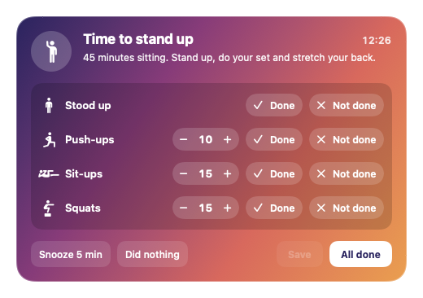
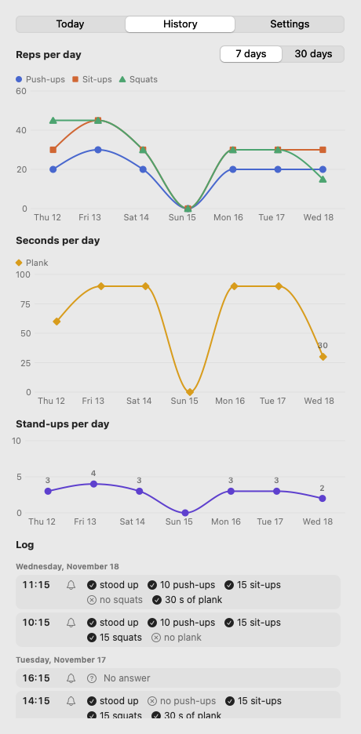
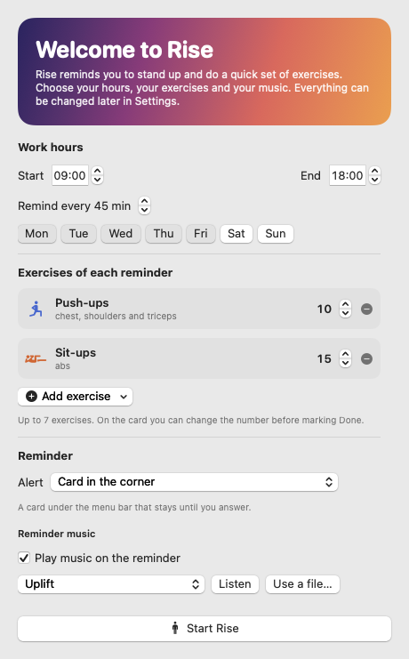

# Rise: stand-up reminder and home workout tracker for macOS

**Rise** is a free and open-source **macOS menu bar app** that reminds you to **stand up at the interval you choose**
(every 45 minutes by default) while you work, and asks whether you did **your set of exercises**: push-ups, sit-ups,
squats, plank or any of 15 bodyweight exercises you can do at home or in the office. Every answer goes into a
**workout history with line charts**, so you can see how much you moved each day instead of sitting all day at the
desk.

🇧🇷 [Leia em português](README.pt-BR.md)

<p align="center"></p>

## Download

**[⬇ Download the latest Rise (.dmg)](https://github.com/VSSSP/rise/releases/latest)**: universal app for Apple
Silicon and Intel Macs, macOS 14 Sonoma or later.

1. Open the dmg and drag **Rise** into **Applications**.
2. Open Rise. Rise is open source but not notarized by Apple, so the first time macOS may say it cannot verify the
   developer: open **System Settings › Privacy & Security** and click **Open Anyway** (or run
   `xattr -dr com.apple.quarantine /Applications/Rise.app` in Terminal).
3. Rise has no Dock icon: it lives in the **menu bar**, next to the clock (the little standing figure).

## Features

- **Stand-up reminder** at the interval you choose (45 minutes by default) in your work hours; start, end, interval
  and weekdays are all configurable.
- **First-run setup**: the first time Rise opens it asks for your hours, your exercises, your alert and your music.
- **Your own exercise set**, up to 7 per reminder, from a catalog of 15 home exercises with the muscles each one
  works: push-ups (chest, shoulders and triceps), sit-ups (abs), squats, lunges, glute bridges, calf raises, chair
  dips, jumping jacks, burpees, mountain climbers, leg raises, supermans, plank, wall sit and stretching. Reps or
  seconds, your number for each.
- **A check-in card that waits** for your answer: mark *Done* or *Not done* for standing up and each exercise, and
  adjust the count. *All done*, *Did nothing* and *Snooze 5 min* are one click. It never steals the keyboard focus.
- **Four alert styles**: a card in the corner, a card in the middle of the screen, full screen (the screen dims
  until you answer) or discreet (only the menu bar icon and the music).
- **Music on the reminder**: pick one of the musical ringtones built into macOS or use your own song, with a volume
  control and a preview.
- **History with line charts** for 7 and 30 days (reps, timed exercises and stand-ups per day) and the full log of
  every reminder, including the ones left without an answer. A wrong entry can be deleted.
- **Themes**: Sunrise, Ocean, Forest, Grape, Graphite and Ember, in light, dark or automatic mode.
- **Menu bar menu**: next reminder, today's totals, log a set by hand, skip the next reminder, pause for today.
- **English and Brazilian Portuguese**, automatic or chosen in Settings.
- **Private**: no account, no network, no tracking. Everything stays on your Mac in
  `~/Library/Application Support/Rise/history.json`.
- Opens at login, and a Mac that slept through a reminder does not ring late.

## Screenshots

<p align="center">
  
  
</p>
<p align="center">
  
</p>

## Build from source

Needs only the Xcode Command Line Tools (`xcode-select --install`), Swift 6.1 and macOS 14 or later.

```sh
git clone https://github.com/VSSSP/rise.git
cd rise
scripts/build.sh            # runs the tests and creates dist/Rise-<version>.dmg
scripts/build.sh --install  # also replaces /Applications/Rise.app and restarts it
swift test                  # only the planner and history tests
```

SwiftPM, AppKit with SwiftUI views and Swift Charts. `Sources/RiseCore` holds the tested logic (the reminder planner
and the history); `Sources/Rise` holds the app.

## License

[MIT](LICENSE). Contributions and translations are welcome.
