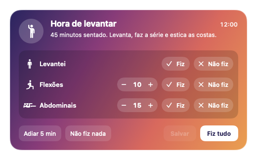
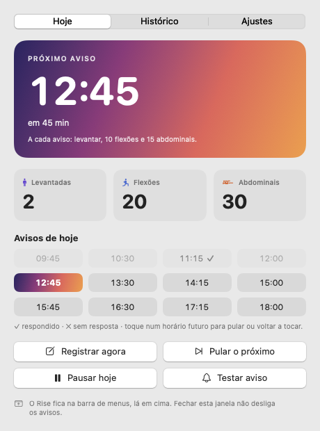
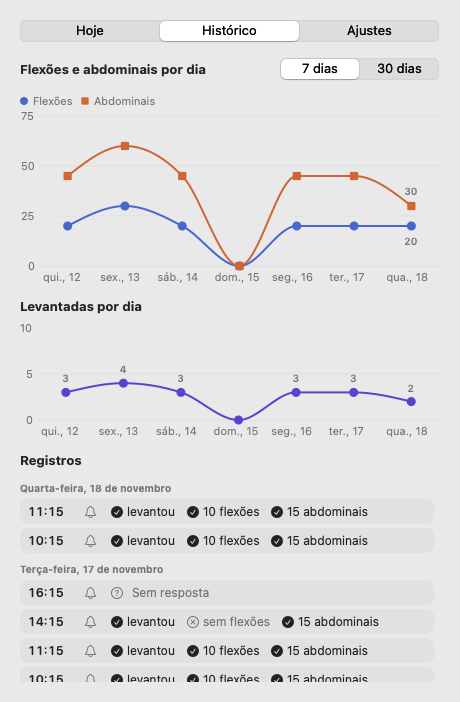

# Rise: lembrete para levantar da cadeira, com flexões e abdominais, para Mac

O **Rise** é um **app gratuito e de código aberto para a barra de menus do macOS** que lembra você de **levantar da
cadeira a cada 45 minutos** durante o expediente e pergunta se você fez as **flexões e os abdominais**. Cada resposta
vai para um **histórico com gráficos em linha**, para você ver quanto se mexeu em cada dia e fugir do sedentarismo
de passar o dia sentado. É uma pausa ativa, uma ginástica laboral no seu ritmo.

🇺🇸 [Read in English](README.md)

<p align="center"></p>

## Baixar

**[⬇ Baixar o Rise mais recente (.dmg)](https://github.com/VSSSP/rise/releases/latest)**: app universal para Macs
com Apple Silicon e Intel, macOS 14 Sonoma ou mais novo.

1. Abra o dmg e arraste o **Rise** para **Aplicativos**.
2. Abra o Rise. Ele é de código aberto, mas não é autenticado pela Apple, então na primeira vez o macOS pode dizer
   que não consegue verificar o desenvolvedor: abra **Ajustes do Sistema › Privacidade e Segurança** e clique em
   **Abrir Mesmo Assim** (ou rode `xattr -dr com.apple.quarantine /Applications/Rise.app` no Terminal).
3. O Rise não fica no Dock: ele mora na **barra de menus**, ao lado do relógio (o bonequinho em pé).

## O que ele faz

- **Lembrete para levantar** a cada 45 minutos no horário de trabalho (início, fim, intervalo e dias da semana você
  escolhe).
- **Um cartão que fica na tela** até você responder: por cima de qualquer app, mesa e tela cheia, sem roubar o foco
  do teclado.
- **Controle de flexões e abdominais**: marque *Fiz* ou *Não fiz* para levantar, flexões e abdominais, e ajuste o
  número antes de salvar. *Fiz tudo*, *Não fiz nada* e *Adiar 5 min* são um clique.
- **Música no aviso**: escolha um dos toques musicais que vêm no macOS ou use uma música sua, com volume e botão
  para ouvir antes.
- **Histórico com gráficos em linha** de 7 e 30 dias (flexões, abdominais e levantadas por dia) e a lista de todos
  os avisos, inclusive os que ficaram sem resposta. Dá para apagar um registro errado.
- **Menu na barra**: próximo aviso, o total de hoje, registrar uma série à mão, pular o próximo aviso, pausar hoje.
- **Português do Brasil e inglês**, automático ou escolhido em Ajustes.
- **Privado**: sem conta, sem internet, sem rastreio. Tudo fica no seu Mac, em
  `~/Library/Application Support/Rise/history.json`.
- Abre sozinho ao iniciar a sessão, e um aviso perdido com o Mac dormindo não toca atrasado.

## Telas

<p align="center">
  
  
</p>

## Gerar a partir do código

Só precisa das ferramentas de linha de comando do Xcode (`xcode-select --install`), Swift 6.1 e macOS 14 ou mais novo.

```sh
git clone https://github.com/VSSSP/rise.git
cd rise
scripts/build.sh            # roda os testes e cria dist/Rise-<versão>.dmg
scripts/build.sh --install  # também troca o /Applications/Rise.app e reabre o app
swift test                  # só os testes do planejador e do histórico
```

## Licença

[MIT](LICENSE). Contribuições e traduções são bem-vindas.
